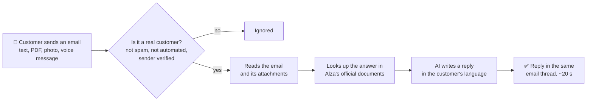
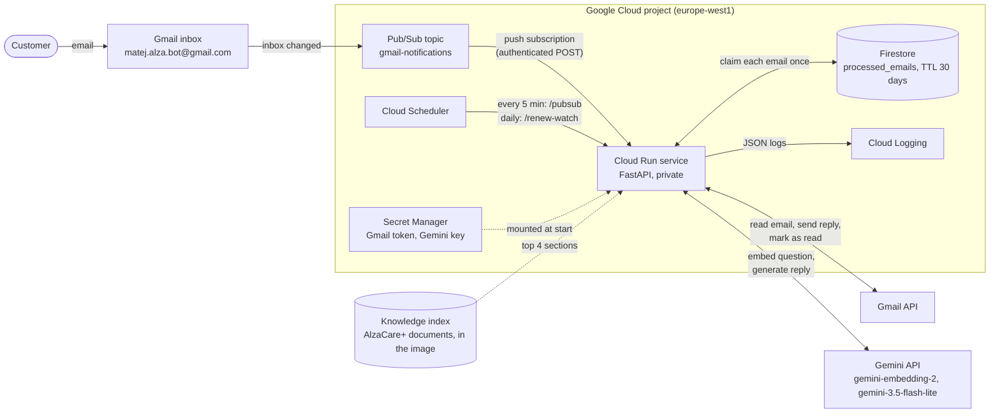
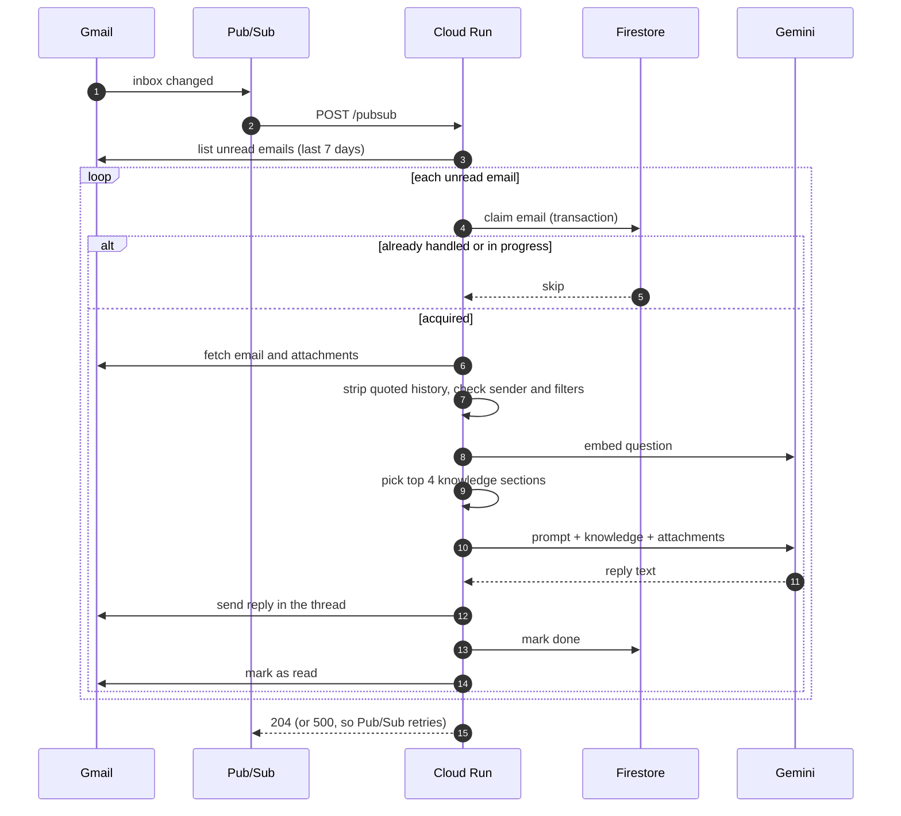

# Email AI Assistant

Proof of concept of an AI assistant that reads incoming emails and replies in the original thread using Gemini.

## How it works

### In plain words



The assistant answers company questions only from Alza's documents. If the answer isn't there, it says so and recommends customer support instead of guessing, and it never promises the outcome of a claim.

### System architecture



### Processing one email



## Knowledge base

`knowledge/alzacare-plus/` contains the documents the assistant answers company-specific questions from. Each `##` section becomes one chunk, embedded with `gemini-embedding-2` into `knowledge/index.json`. After editing any document, rebuild the index with `uv run python -m app.rag build` (a test fails if the index is out of date). **AlzaCare+ is a fictional service created for this proof of concept**; its name, prices and terms are invented and do not describe any real Alza product or its actual terms.

Before searching, the email is split into separate questions (one structured-output call), and each question gets its own share of the top sections. One embedding for a whole email with several questions missed some topics.

### Evaluation

`uv run python -m evals.run` runs 20 test emails (`evals/cases.json`) three times each: answerable questions, questions it must decline (product prices, order status, delivery times), several questions in one email, English, Czech and German, and a prompt injection. It checks that the expected sections were retrieved, that required facts (e.g. prices) appear, and asks an LLM judge whether the reply meets the case's criterion. It uses the same API quota as the deployed assistant, so don't run it while the assistant is in use.

| | Before question splitting | After |
| --- | --- | --- |
| Expected sections retrieved | 14/15 | 15/15 |
| Replies passing | 53/60 (88 %) | 59/60 (98 %) |
| Email with three questions | 0/3 | 3/3 |

Limits: the judge is the same small model as the assistant (the stronger one has only 20 free requests a day), so failures were reviewed by hand. That review found a judge mistake and a real issue it missed: a Czech question was sometimes answered in Slovak or a Czech-Slovak mix, likely because the knowledge base is in Slovak.

## Development

Requires [uv](https://docs.astral.sh/uv/).

```bash
uv sync                      # install dependencies
cp .env.example .env         # then fill in your values
```

| Command                                                         | What it does                                                                   |
| --------------------------------------------------------------- | ------------------------------------------------------------------------------ |
| `uv run python -m app.processor`                                | Process unread emails in the bot inbox and reply                               |
| `uv run python -m app.try_reply --body "..." [--subject "..."] [--attach file]` | Print the bot's reply to a hand-written email; nothing is sent; `--attach` is repeatable |
| `uv run uvicorn app.main:app --reload`                          | Run the web service used on Cloud Run (`POST /pubsub`, `POST /renew-watch`)    |
| `uv run pytest`                                                 | Fast offline tests (no Gmail, no Gemini)                                       |
| `uv run pytest -m live -s`                                      | Behavioural tests against the real Gemini API; prints replies for human review |

### Configuration (`.env`)

| Variable                | Description                                                    |
| ----------------------- | -------------------------------------------------------------- |
| `GEMINI_API_KEY`        | Gemini API key from Google AI Studio                           |
| `GEMINI_MODEL`          | Primary model (default `gemini-3.5-flash-lite`)                |
| `GEMINI_FALLBACK_MODEL` | Used when the primary model fails (default `gemini-3.8-flash`) |
| `LOG_FILE`              | Optional path for a rotating log file, e.g. `logs/app.log`     |
| `GMAIL_TOKEN_FILE`      | Path to the Gmail OAuth token (default `token.json`)           |
| `PUBSUB_TOPIC`          | Pub/Sub topic for Gmail notifications, `projects/<project>/topics/<topic>` |

The processor records handled emails in Firestore, so running it locally also needs Google Cloud credentials: `gcloud auth application-default login`. `try_reply` and the tests don't use Firestore.

Gmail access uses OAuth: put the OAuth client file at `credentials.json` and run `uv run python -m app.gmail_client login`, which opens a browser and stores the token in `token.json`. Both files are git-ignored. The token contains the client ID and secret, so `credentials.json` is only needed for logging in.

## Deployment (Google Cloud)

Gmail publishes inbox changes to a Pub/Sub topic, whose push subscription calls the private Cloud Run service (`POST /pubsub`). The service processes all unread emails from the last 7 days. Cloud Scheduler renews the Gmail watch daily (it expires after 7 days) and calls `/pubsub` every 5 minutes as a fallback for missed notifications.

- `scripts/setup.sh`: one-time setup of a new project (APIs, Firestore, secrets, service accounts, Cloud Run, Pub/Sub, Scheduler). Prerequisites are listed at the top of the script.
- `scripts/deploy.sh`: build and deploy a new revision after a code change.
- Settings (project, region, names) are in `scripts/config.sh`.

| Service account | Used by | Permissions |
| --- | --- | --- |
| `alza-bot` | the running service | read the two secrets, read/write Firestore |
| `alza-bot-invoker` | Pub/Sub push, Cloud Scheduler | invoke the Cloud Run service |
| `alza-bot-builder` | Cloud Build | build and store the container image |

The Gmail token and Gemini API key are stored in Secret Manager; the token is mounted as a file, the key as an environment variable.

## Attachments

Supported attachments are sent to Gemini inline together with the email text:

- **Documents:** PDF, Word, Excel (first sheet only), PowerPoint, OpenDocument, CSV
- **Audio:** MP3, WAV, M4A, AAC, OGG, Opus, FLAC, AIFF, WebM
- **Images:** JPEG, PNG, WebP, GIF, HEIC/HEIF, BMP, TIFF
- **Video:** MP4, MOV, WebM, AVI, MPEG, WMV, FLV, 3GP (a `.webm` of unknown type is sent as video: Gemini also handles audio-only files that way, whereas a video sent as audio loses its picture)

Unsupported, empty or oversized files are skipped and listed in the prompt, so the reply can tell the customer which file couldn't be read. At most 10 attachments and 14 MB in total are processed (Gemini's 20 MB request limit including base64 overhead).

## Security

An auto-responder can be abused to send email to third parties (e.g. a forged `From`/`Reply-To` pointing at a victim). Current safeguards:

- **Sender authentication:** emails that fail Gmail's DMARC check, or pass neither SPF nor DKIM, are skipped. Only Gmail's own (topmost) `Authentication-Results` header is trusted.
- **No replies to automated senders:** own address, no-reply addresses (checked on the address the reply would go to), `Auto-Submitted`, bulk `Precedence` and mailing lists.
- **Loop prevention:** replies carry `Auto-Submitted: auto-replied` (RFC 3834).
- **Exactly one reply per email:** before processing, an instance claims the email in Firestore in a transaction, so concurrent instances or duplicate notifications don't answer twice. A claim abandoned by a crashed instance expires after 5 minutes; records are deleted after 30 days by a Firestore TTL policy. Only emails from the last 7 days are processed, so an old email marked unread again after its record expired is not answered twice.
- **Prompt-injection guard:** email subject and body are passed to the model as delimited, untrusted input.
- **Data minimization:** the sender's address is not sent to the LLM; Gemini interactions are not stored (`store=False`).

### Known limitations

- **Only the newest message in a thread is used:** the quoted previous message below a reply (`> ...` lines with their "On ... wrote:" line) is removed, so it doesn't distort knowledge retrieval. The bot therefore doesn't see earlier messages; planned: pass the thread history to the model separately and retrieve knowledge for the new message only. Outlook-style quotes without `>` are not detected yet.

- **No rate limiting yet:** a sender with a properly authenticated domain could still set `Reply-To` to a victim. Planned: per-recipient and global reply limits.
- **Attachments over 14 MB are skipped:** Gmail allows up to 25 MB. Larger files could be sent via the Gemini Files API, which however keeps uploaded files for up to 48 hours.
- **No output validation yet:** a prompt injection could make the model include arbitrary links. Planned: block links outside an allow-list of domains.
